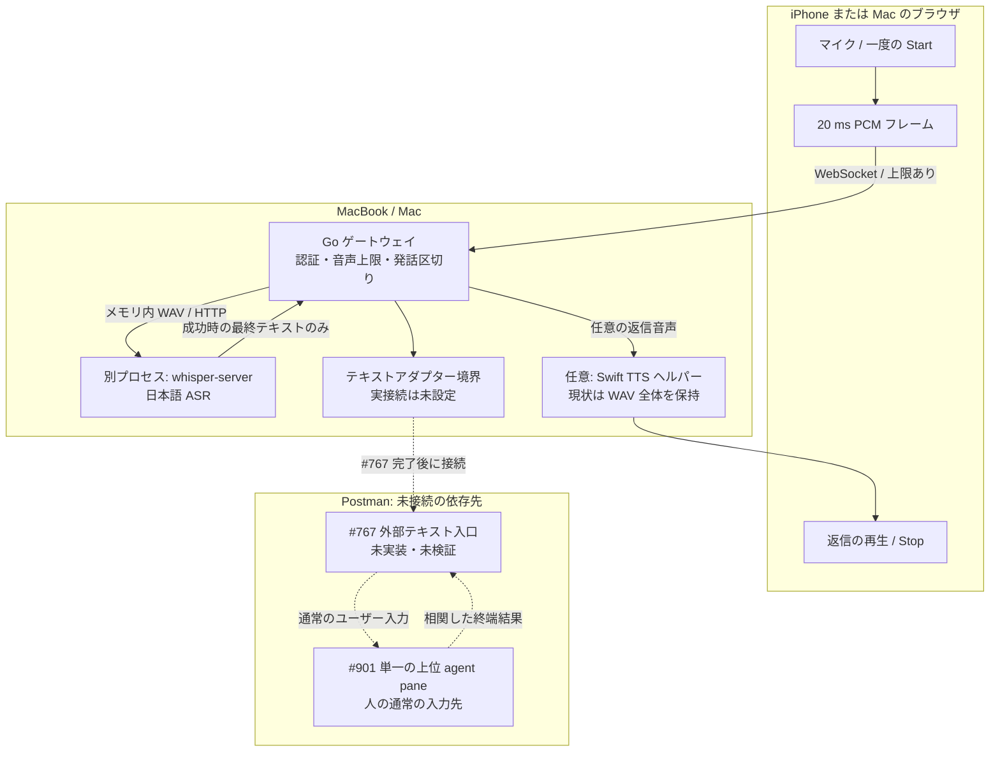
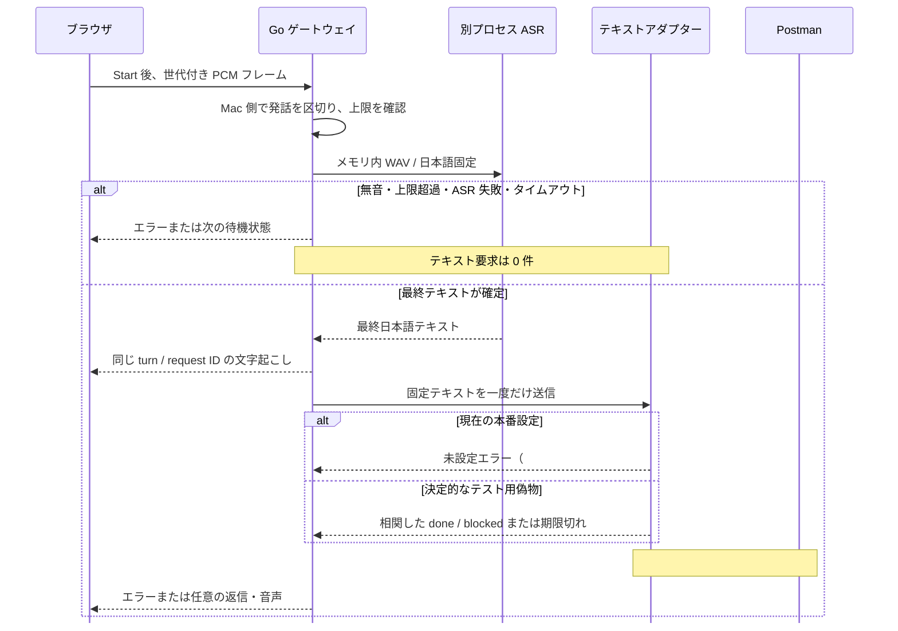

# 音声ゲートと Postman 接続境界

この文書は Issue #2 の小さな実装範囲を示します。現在のコードは iPhone または Mac のブラウザから Mac の Go ゲートウェイへ音声フレームを送り、Mac 側で発話を区切ってローカル `whisper-server` に日本語の文字起こしを依頼します。`whisper-server` とモデルは別プロセスで、起動・モデルの固定・実音声での精度確認は運用側の作業です。テストでは決定的な偽物を使い、実機や実モデルの成功を主張しません。

## 機器とプロセス

ブラウザは音声の境界を決めません。ゲートウェイは一つの前景セッションだけを受け付け、受信・発話・文字数・待ち時間を制限します。Go コードは入力音声をアプリ所有の永続ファイルに書きません。別プロセス、フレームワーク、OS の一時ファイルやスワップについて SSD 書き込みゼロは保証できません。

## リクエストと応答の順序

Stage 1 は音声から一つの最終テキストを得るまでです。失敗した場合、アダプターへの呼び出しはありません。Stage 2 は固定済みのテキストから始まり、期限付きの一回の呼び出しで終端結果 `done` または `blocked` を受け取ります。現在の `UnavailableAdapter` は Postman へ何も送信しません。テスト用の偽物は二つのゲートと結合順序だけを確認します。実際の認証入口、永続的な重複排除、再試行・再起動時の相関、上位 pane への通常入力、端末結果の取得は Postman #901 と #767 の受入れ後に検証します。

アダプターが期限を無視して停止しない場合でも、ゲートウェイは期限で待機を終え、そのセッションを閉じます。遅れて返った結果は返信や TTS に使いません。アダプターの処理が実際に終了するまで次のセッションを受け付けないため、外部処理が残ったまま次の要求と重なることはありません。外部処理自体の取り消しや、その処理が行った副作用の取り消しは保証しません。

現行の TTS 経路は返信を WAV 全体としてバッファーに保持し、ブラウザへのイベントも全体を base64 で送ります。増分配信や物理 iPhone Safari の再生試験は完了していません。
